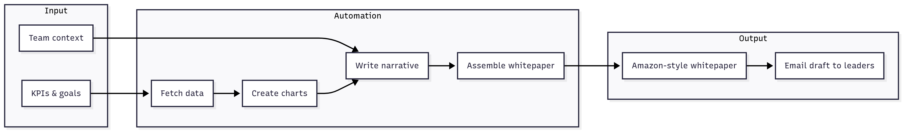

# ai-qbr-reporter

Turns a quarter's KPIs into a draft business review: it pulls the numbers, renders charts, has Amazon Bedrock write the narrative, assembles a Word whitepaper, and emails the package, marked as a draft, to a review list.



Built during a hackathon to cut the hours teams spend assembling monthly and quarterly business reviews (MBR/QBR) by hand.

## How it works

1. **Trigger**: an EventBridge schedule (monthly or quarterly) or a `POST /run` call starts a Step Functions pipeline.
2. **Fetch KPIs**: a Lambda reads curated KPI data and validates it against a typed schema.
3. **Render charts**: a Lambda draws the period's charts with matplotlib and stores them in S3.
4. **Write the narrative**: a Lambda calls Bedrock with a system prompt that requires every claim to come from the KPI data or retrieved documents, and to say "insufficient data" when it can't. A Bedrock Knowledge Base supplies team context, and a Bedrock Guardrail filters output.
5. **Assemble the whitepaper**: a Lambda builds a .docx with a title page, metrics overview, charts, narrative sections, and citations.
6. **Deliver**: a Lambda emails the package through SES with a `[Draft]` subject to a configured review list. A simulate mode logs the email instead of sending it.

Infrastructure is defined twice, in AWS CDK (TypeScript) and in a standalone SAM template, with KMS encryption, Secrets Manager for webhooks, and an SNS topic for pipeline failures. Diagrams are in [docs/diagrams](docs/diagrams).

## Status

Hackathon prototype. CI runs the unit tests, compiles the CDK app, and synthesizes all five CloudFormation stacks. It has not been deployed to production. Packaging Lambdas that share the `common` module needs work before a deploy.

CI synthesizes with `-c skipBundling=true` so it doesn't need Docker; a normal `cdk synth` or `cdk deploy` bundles the Python layer as usual.

```bash
pip install -r layers/python311/requirements.txt -r app/tests/requirements-test.txt
cd app/tests && pytest
```

## Prerequisites
- Node.js 18+
- Python 3.11
- AWS CLI v2 configured for the target account
- AWS CDK v2 (`npm install -g aws-cdk`)
- AWS SAM CLI (`pip install aws-sam-cli` or download the installer)
- Access to Amazon Bedrock in the chosen region

## One-Time Setup
1. `npm install`
2. `cdk bootstrap aws://<account>/<region>`
3. Copy `infra/parameters.example.json` to `infra/parameters.json` and customize values (sender email, Bedrock model ID, execution toggles).

## Deploy (dev)
```bash
npm run build
cdk synth
cdk deploy --all
```

## AWS SAM Deployment (Lambda-first)
The repository also includes a self-contained AWS SAM template for teams that prefer CloudFormation-native workflows.

```bash
sam build --template-file infra/sam-template.yaml
sam deploy \
  --template-file infra/sam-template.yaml \
  --stack-name ai-qbr-reporter \
  --capabilities CAPABILITY_IAM CAPABILITY_NAMED_IAM CAPABILITY_AUTO_EXPAND \
  --parameter-overrides \
    BedrockModelId=anthropic.claude-3-sonnet-20240229-v1:0 \
    SenderEmail=exec@example.com \
    AllowedSenderEmails=exec@example.com,ops@example.com
```

Key parameters:
- `BedrockModelId` (required): foundation model ID used by the narrative Lambda.
- `SenderEmail` (required): SES-verified address for outbound communication.
- `AllowedSenderEmails`: optional CSV allowing additional `From` addresses.
- `MonthlySchedule` / `QuarterlySchedule`: EventBridge cron expressions (defaults align with CDK).
- `SlackWebhookSecretArn`: optional Secrets Manager ARN for Slack notifications.

Outputs surface the API endpoint, Step Functions ARN, S3 bucket names, KMS key ARN, and failure SNS topic.

## Triggering a Run
- EventBridge: pipeline runs automatically per the scheduled rule (monthly/quarterly configurable).
- On-demand: invoke the API Gateway endpoint with `POST /run` and a JSON body containing `period`, `audience`, and optional `goals`/`risks`.

## Cleaning Up
```bash
cdk destroy --all
```

## Repository Layout
- `bin/` CDK app entry point
- `lib/` CDK stacks (data lake, analytics engines, Bedrock integration, Step Functions pipeline, SES/email, app stack)
- `app/` Python Lambda code, prompts, and pytest suite
- `layers/` Lambda layer dependencies (Python 3.11)
- `infra/` deployment parameters and SAM template
- `.github/workflows/` CI pipeline definition
- `Makefile` convenience targets (`init`, `build`, `deploy`, `destroy`, `test`, `lint`)
